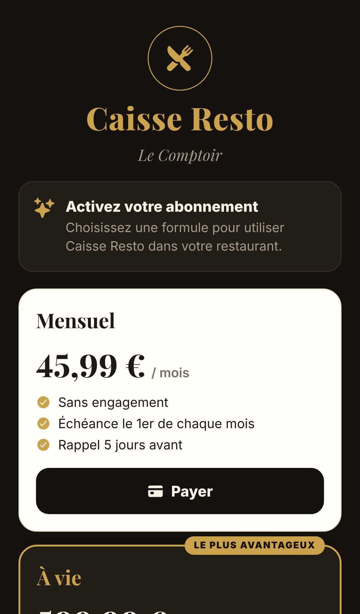
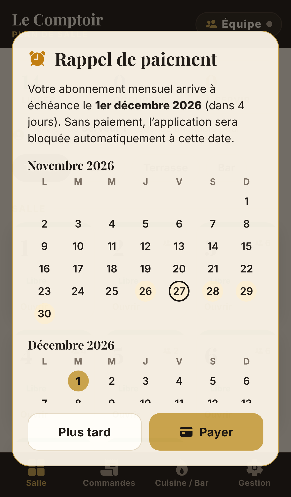
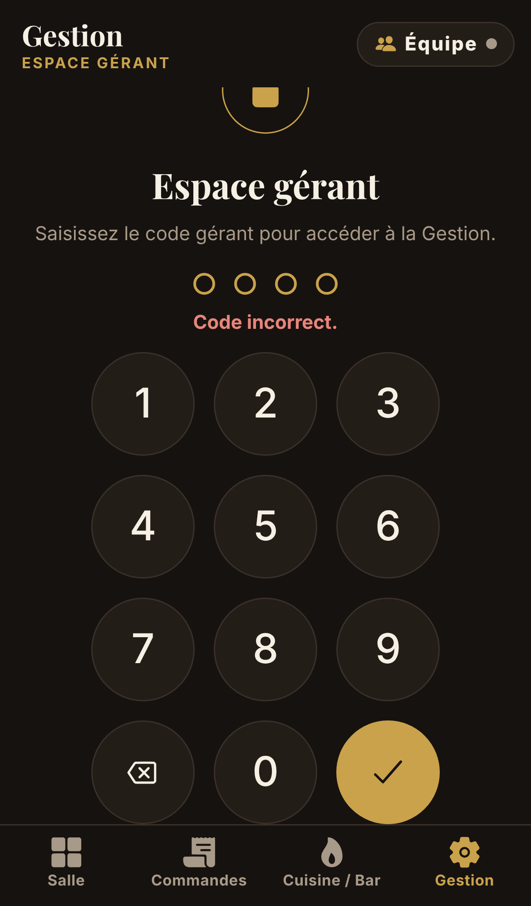

# Caisse Resto

Application de prise de commande pour restaurant, pensée pour les serveurs, la cuisine et le bar.
Elle fonctionne sur **iPhone, Android** et **navigateur** (à installer sur l’écran d’accueil).

| Salle | Prise de commande | Cuisine & Bar | Lobby de l’équipe |
|---|---|---|---|
|  |  |  |  |

| Abonnement | Rappel de paiement | Code gérant |
|---|---|---|
|  |  |  |

## Fonctionnalités

**Salle** : plan des tables par zones. La couleur indique l’état : libre, en cours, à envoyer ou prêt à servir. Chaque table affiche le montant, la durée et le serveur. Toucher une table ouvre sa commande.

**Prise de commande, en trois gestes** : table → plats → **Envoyer**.
- Barre de catégories en haut. Toucher un plat l’ajoute ; un bouton « − » apparaît sur la carte du plat.
- En bas : le ticket (total, nombre d’articles) et le bouton **Envoyer**, qui ramène au plan de salle (réglable).
- Le ticket permet de modifier les quantités, les couverts et les notes (« saignant », « sans glaçons »…), de marquer les plats « Servis », d’encaisser (espèces, carte, autre ; TVA et montant par couvert) et d’annuler.
- Sur tablette, le ticket reste affiché à droite de la carte.

**Commandes** : commandes en cours, avec trois filtres : toutes, les miennes, à servir.

**Cuisine / Bar** : un ticket par envoi, avec chronomètre. Le ticket passe en rouge en cas de retard. Toucher une ligne la fait avancer : envoyé → en préparation → prêt. Les tickets prêts récemment peuvent être rappelés.

**Gestion**, protégée par le **code gérant** :
- articles et prix, catégories (envoi en cuisine ou au bar), tables et zones, serveurs ;
- restaurant (nom, devise, TVA, alerte cuisine, retour au plan de salle) ;
- historique et statistiques, abonnement, code gérant, données.

**Équipe / lobby** : le gérant crée un lobby avec un **code d’accès à 6 caractères**. Serveurs et cuisiniers le rejoignent depuis leur téléphone. Commandes, plats prêts, carte et tables sont alors partagés en direct (environ 2 secondes), avec une file d’attente si le réseau coupe. Chaque appareil choisit son prénom et son poste : « Salle / serveur », ou « Cuisine / bar » qui n’affiche que les tickets.

**Abonnement** :
- **Mensuel : 45,99 €** par mois, dû le 1er. Un rappel s’affiche 5 jours avant (fenêtre une fois par jour et bandeau permanent), avec un calendrier. Si le paiement n’est pas enregistré, l’application est **bloquée automatiquement** le 1er à minuit.
- **À vie : 599,99 €** en paiement unique.
- Le bouton « Payer » ouvre votre lien de paiement (par exemple un lien Stripe). Le client saisit ensuite le **code d’activation** que vous lui envoyez.
- Tous les appareils d’un lobby partagent la licence du restaurant.

**Administration**, avec le code administrateur. Saisi dans le champ « Code d’activation », ce code débloque une licence à vie et ouvre l’écran **Gestion › Administration**. On peut y :
- prolonger d’un mois, passer à vie ou révoquer la licence ;
- retirer au gérant l’accès à la Gestion ou la création de lobby, et réinitialiser son code ;
- générer les **codes d’activation** de vos clients (mensuel pour un mois donné, ou à vie) à partir de leur identifiant de licence ;
- renseigner les liens de paiement, et fermer le lobby.

## Mettre l’application en ligne (Netlify) et l’installer sur iPhone

```bash
npm install
npm run build:netlify     # crée caisse-resto-netlify.zip
```

1. Déposez le zip sur [app.netlify.com/drop](https://app.netlify.com/drop) (compte gratuit obligatoire : sans compte, le site est supprimé au bout d’une heure).
2. Ouvrez l’adresse Netlify dans **Safari**, puis **Partager › Sur l’écran d’accueil**.
3. Pour une mise à jour, déposez le nouveau zip dans **Deploys** du même site.

## Activer le lobby (serveur Supabase, environ 5 minutes, gratuit)

Pour que plusieurs téléphones partagent les commandes, il faut un serveur. L’application utilise Supabase.

1. Créez un compte et un projet sur [supabase.com](https://supabase.com) (offre gratuite).
2. **SQL Editor › New query** : collez le contenu de [`supabase/schema.sql`](supabase/schema.sql), puis **Run**.
3. Récupérez l’**adresse du projet** (`https://xxxx.supabase.co`) et la **clé publique** (*publishable* ou *anon*) dans les paramètres API du projet.
4. Dans l’application, en tant que gérant : **Équipe › Créer le lobby**, collez l’adresse et la clé, puis **Créer**.
5. **Inviter l’équipe** partage un lien qui contient le code et l’adresse du serveur. Les employés l’ouvrent dans Safari et choisissent leur prénom et leur poste.

À savoir :
- la clé publique est prévue pour être visible ; les tables ne sont accessibles qu’à travers les fonctions du schéma ;
- l’offre gratuite de Supabase met en pause un projet inactif pendant une semaine (il se relance depuis le tableau de bord) ;
- pour intégrer le serveur à l’application sans saisie, définissez `EXPO_PUBLIC_SUPABASE_URL` et `EXPO_PUBLIC_SUPABASE_KEY` avant `npm run build:netlify`.

## Limites à connaître

- **Les contrôles d’abonnement et de codes sont faits par l’application, sur l’appareil.** Ils protègent contre un usage normal, pas contre une personne qui modifie le code ou les données du navigateur. Pour une protection forte, il faut un serveur de licences relié au paiement (par exemple un webhook Stripe), ce qui permettrait aussi l’activation automatique après paiement.
- Le paiement n’est pas encore automatisé : après réception d’un paiement, l’administrateur génère un code d’activation et l’envoie au client.
- Hors lobby, chaque appareil garde ses propres données.

## Autres façons de l’installer

- **Tester avec Expo Go** : `npx expo start`, puis scanner le QR code avec l’application Expo Go.
- **Applications natives (App Store / Play Store)** avec EAS Build : modifiez `ios.bundleIdentifier` et `android.package` dans `app.json`, puis :
  ```bash
  npx eas-cli@latest build --platform android --profile preview   # APK Android
  npx eas-cli@latest build --platform ios --profile production    # compte Apple Developer requis
  ```

## Développement

```bash
npm test            # tests : commandes, cuisine, encaissement, synchronisation, abonnement, codes
npm run typecheck   # vérification TypeScript
```

```
src/
  app/                    écrans (Expo Router)
    (tabs)/               Salle, Commandes, Cuisine / Bar, Gestion
    commande/[id].tsx     prise de commande et encaissement
    equipe.tsx            profil de l’appareil et lobby
    abonnement.tsx        formules, calendrier des paiements
    reglages/             écrans de la Gestion (dont admin.tsx)
  store/
    ops.ts                opérations rejouables (base de la synchronisation)
    actions.ts            création des opérations (identifiants, horodatages)
    StoreProvider.tsx     données, sauvegarde, boucle de synchronisation du lobby
  sync/backend.ts         appels au serveur Supabase, liens d’invitation
  license/                abonnement, rappels, codes d’activation, droits gérant / admin
  components/             interface (thème, pavé numérique, calendrier, verrous…)
supabase/schema.sql       tables et fonctions du serveur de synchronisation
```
