# Caisse Resto

Application de prise de commande pour restaurant, pensée pour les serveurs, la cuisine et le bar.
Elle fonctionne sur **iPhone, Android** et **navigateur** (à installer sur l’écran d’accueil).

| Salle | Prise de commande | Cuisine & Bar | Gestion |
|---|---|---|---|
| 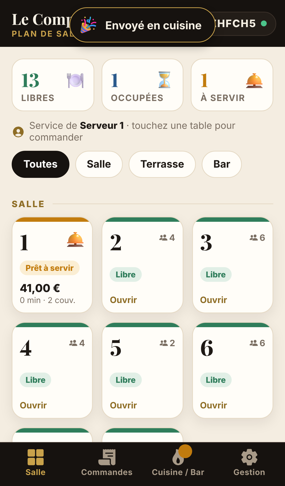 | 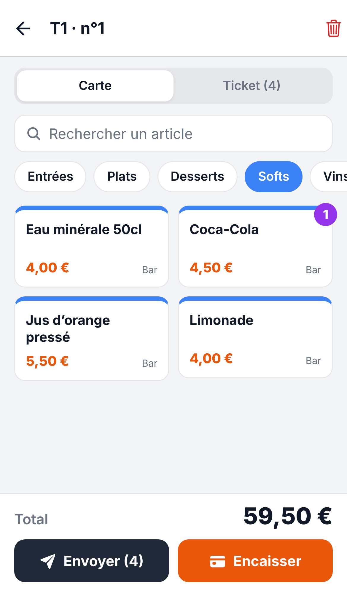 | 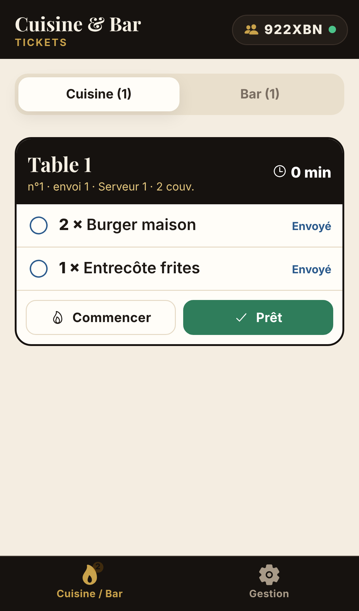 | 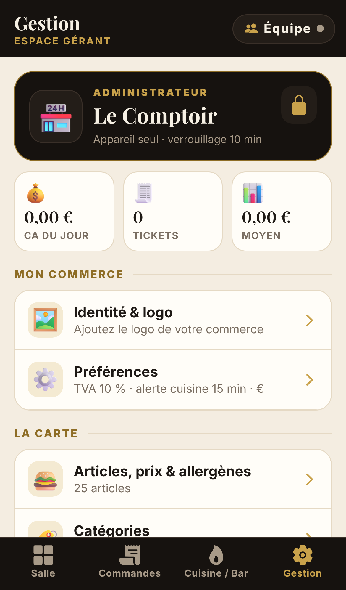 |

| Lobby + QR code | Paiement | Mode démo | Tablette |
|---|---|---|---|
| 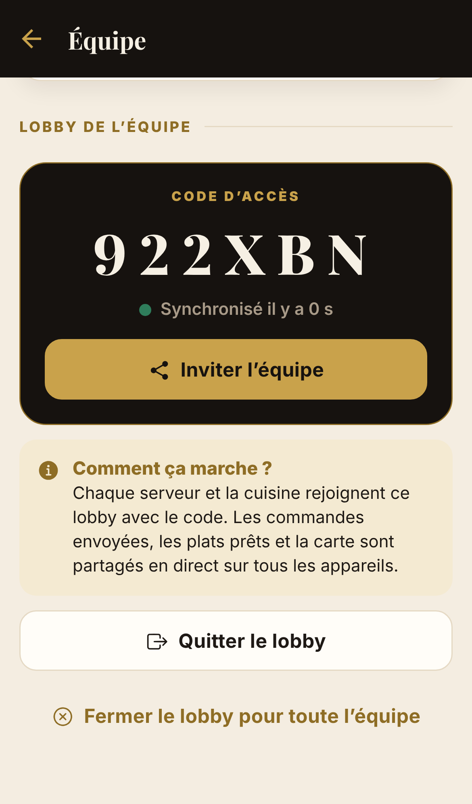 | 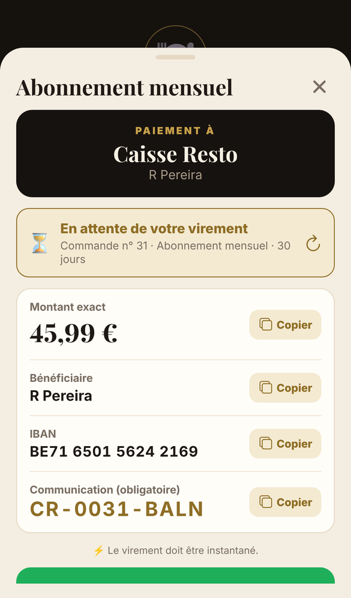 | 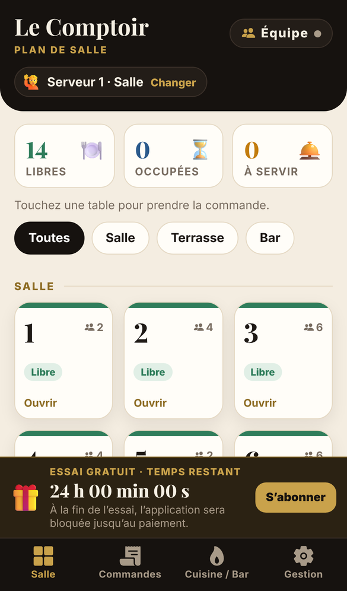 | 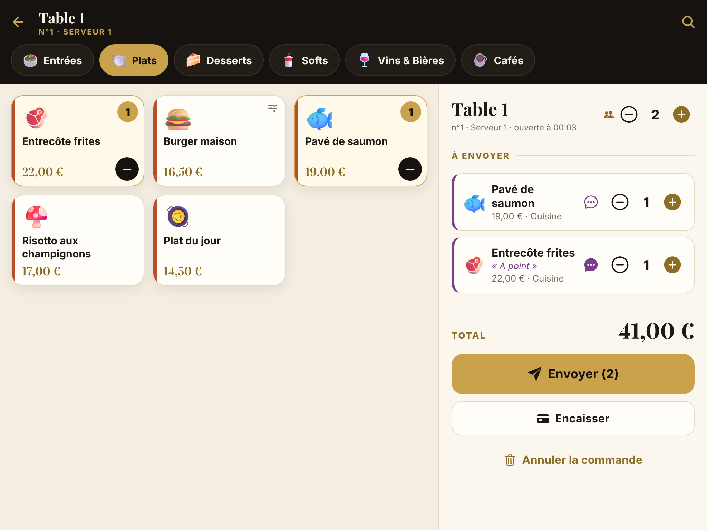 |

| Encaissement + pourboire | Ticket de caisse | Historique & stats | Clôture de minuit |
|---|---|---|---|
| 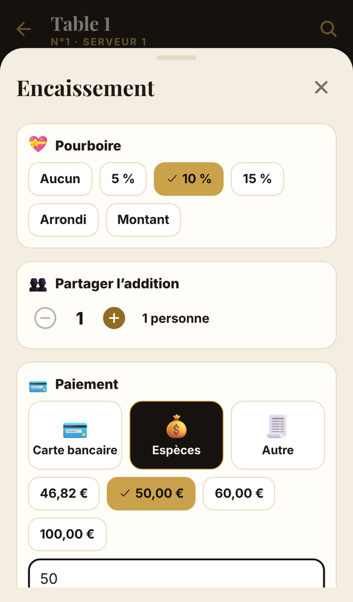 | 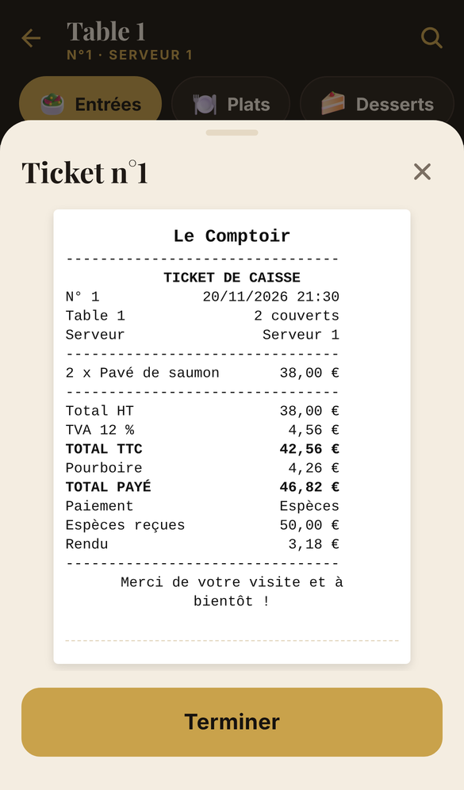 | 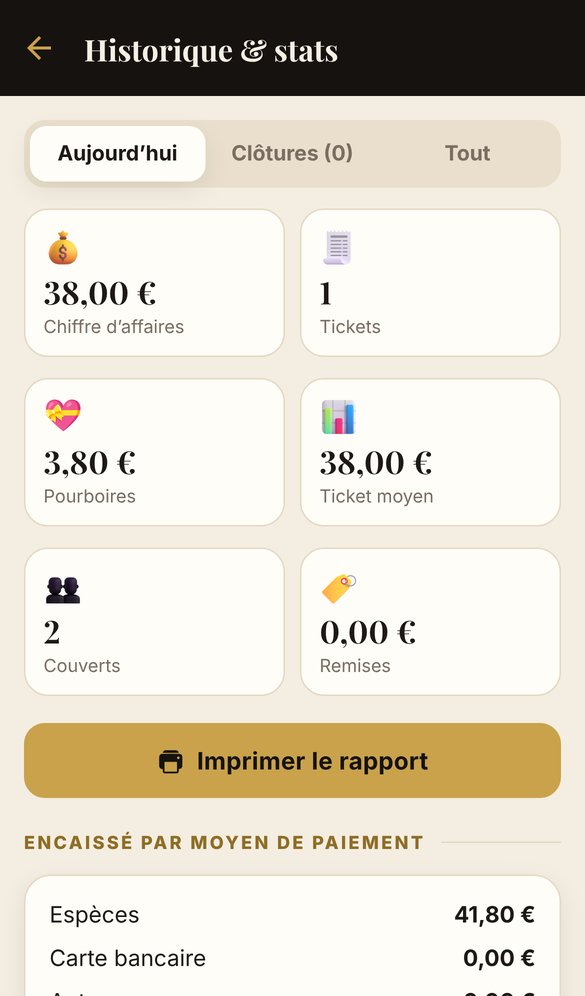 | 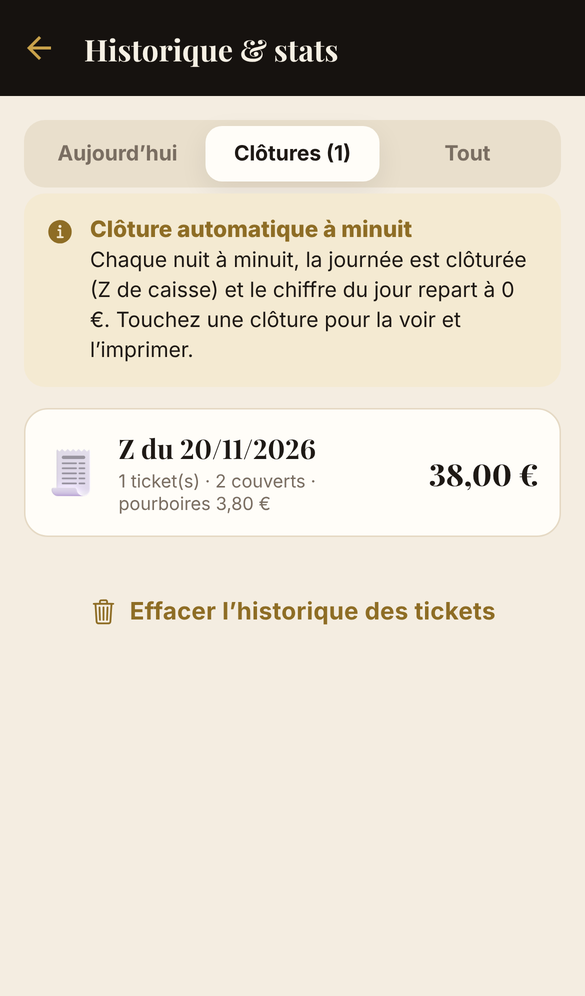 |

| Équipe & postes | Poste Cuisine (lobby) | Espace créateur | Clé d’activation |
|---|---|---|---|
| 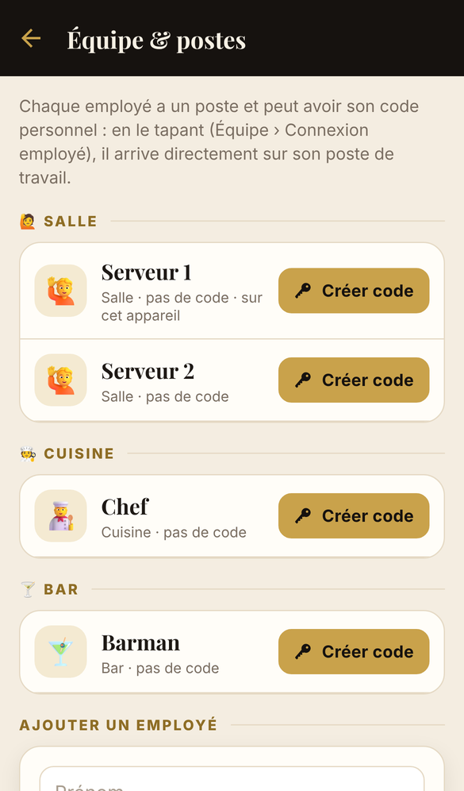 | 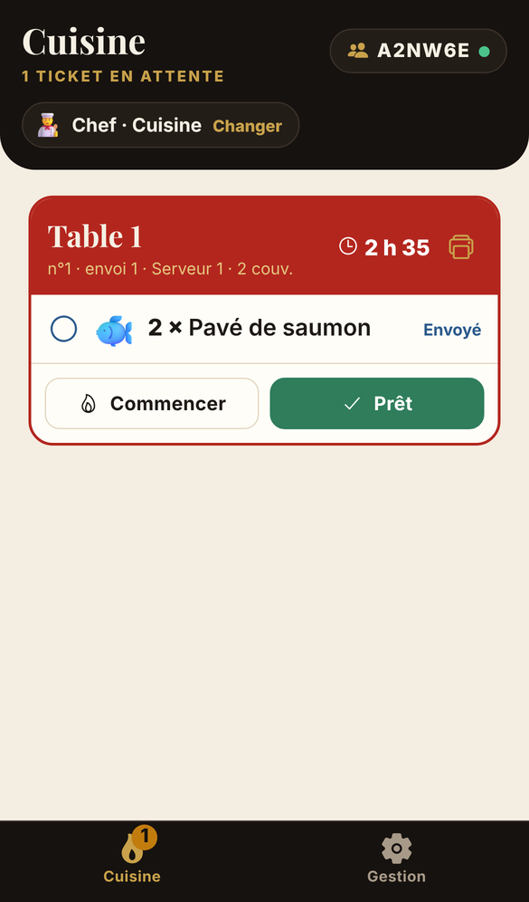 | 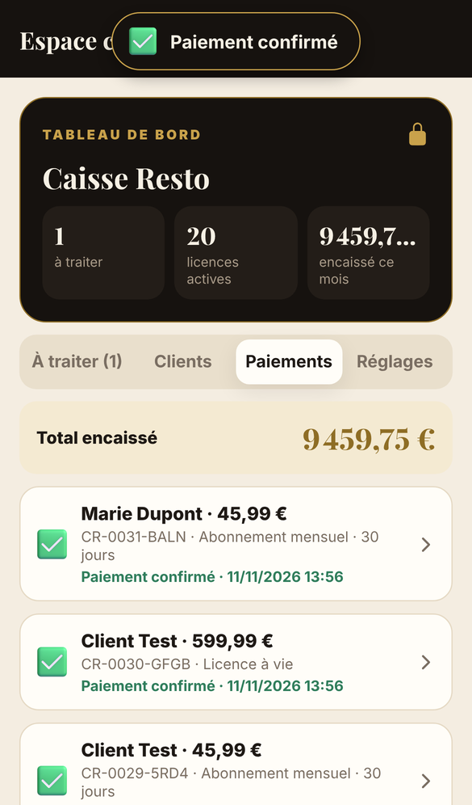 | 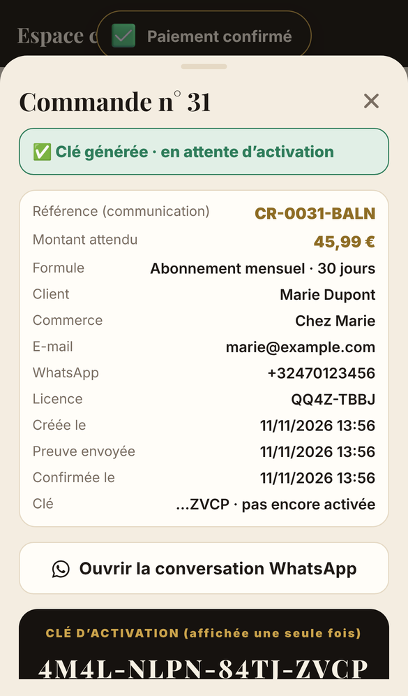 |

| Rappel : 5 jours en orange, fin en rouge |
|---|
| 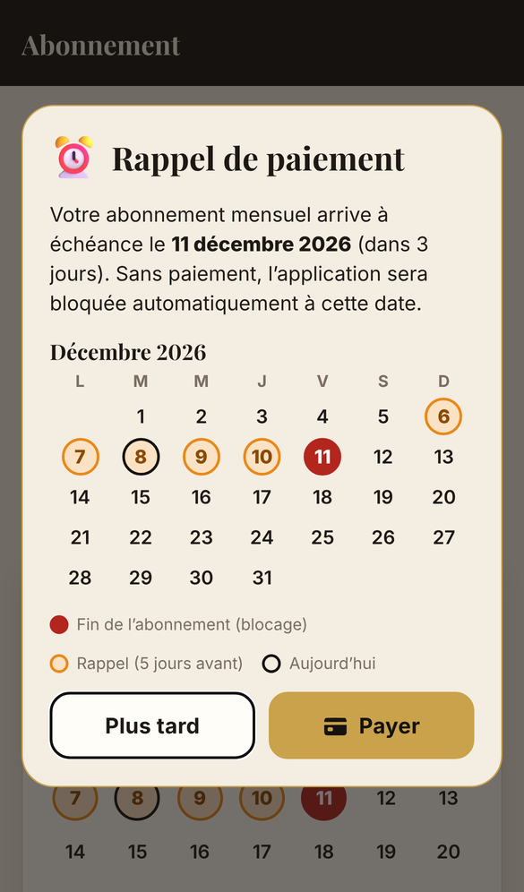 |

## Fonctionnalités

**Salle** : plan des tables par zones. La couleur indique l’état : libre, en cours, à envoyer ou prêt à servir. Chaque table affiche le montant, la durée et le serveur. Toucher une table ouvre sa commande.

**Prise de commande, en trois gestes** : table → plats → **Envoyer**.
- Barre de catégories en haut, emojis 3D sur chaque plat. Toucher un plat l’ajoute ; un bouton « − » apparaît sur la carte du plat.
- Les plats avec **choix** (cuisson, Normal/Zéro…) ouvrent un choix rapide, avec les **allergènes** affichés.
- En bas : le ticket (total, nombre d’articles) et le bouton **Envoyer**, qui ramène au plan de salle (réglable).
- Le ticket permet de modifier les quantités, les couverts et les notes (« saignant », « sans glaçons »…), de marquer les plats « Servis », de **changer de table** et d’annuler. Le total affiché pendant la commande est **hors TVA** : la TVA est choisie à l’encaissement.

**Encaissement** : une seule fenêtre, de haut en bas :
- **TVA (obligatoire)** : 0 %, 6 %, 12 % ou 21 %, **ajoutée au montant**. Aucun taux n’est présélectionné : sans choix, le bouton d’encaissement reste bloqué ;
- **pourboire** : Aucun, 5 %, 10 %, 15 %, Arrondi à l’euro supérieur, ou montant libre ;
- **remise** en % et **partage de l’addition** (montant par personne) ;
- **mode de paiement** (carte, espèces, autre) ; en espèces, montants proposés et **monnaie à rendre** calculée ;
- bouton « Encaisser X € », puis **ticket de caisse** affiché à l’écran.

**Ticket de caisse** : nom, adresse, téléphone et **N° de TVA** du commerce, numéro du ticket, date et heure, table, serveur, articles, total HT, TVA au taux choisi et total TTC, remise, pourboire, total payé, mode de paiement, espèces reçues et rendu, message de bas de ticket personnalisable.

- Sur tablette, le ticket reste affiché à droite de la carte.

**Commandes** : commandes en cours, avec trois filtres : toutes, les miennes, à servir.

**Cuisine / Bar** : un ticket par envoi, avec chronomètre. Le ticket passe en rouge en cas de retard. Toucher une ligne la fait avancer : envoyé → en préparation → prêt. Les tickets prêts récemment peuvent être rappelés.

**Gestion**, protégée par le **code gérant** :
- **identité & logo** : le gérant ajoute le logo de son commerce (affiché sur le plan de salle, la Gestion et l’écran d’accueil), le nom, le slogan, l’adresse, le téléphone, le **N° de TVA de l’entreprise** et le message du bas de ticket ;
- **carte complète** : articles avec emoji 3D, prix, description, **choix à la commande**, **14 allergènes**, disponibilité, duplication et ordre d’affichage ; catégories avec emoji, couleur et poste (cuisine ou bar) ;
- tables et zones, **équipe & postes**, lobby de l’équipe ;
- préférences (devise, alerte cuisine, retour au plan de salle, **sécurité / verrouillage**) ;
- **historique & statistiques** : aujourd’hui, clôtures, tout ; chiffre d’affaires, tickets, couverts, ticket moyen, **pourboires**, remises, répartition par mode de paiement, meilleures ventes, **TVA collectée** (par taux) ;
- abonnement, code gérant ;
- **données** : « Partir de zéro », « Recharger la carte de démonstration » et « Effacer l’historique des tickets » exigent le **code créateur** (réservé au créateur de l’application) ;
- **contact** : en cas de souci ou de besoin d’aide, WhatsApp ou téléphone au **+32 465 53 88 69**, disponible 24 h/24.

**Clôture automatique à minuit** : chaque nuit à minuit, la journée est clôturée (Z de caisse : chiffre d’affaires, TVA, pourboires, paiements, meilleures ventes) et le chiffre du jour repart à **0 €** ; la numérotation des tickets aussi. Si l’application était fermée à minuit, la clôture se fait à sa réouverture. Les clôtures restent consultables dans l’historique.

**Code gérant** : ouverture automatique dès le dernier chiffre, blocage progressif après 5 erreurs, changement de code avec l’ancien code (codes trop simples refusés), « Code oublié ? » renvoie vers l’administrateur. Sécurité au choix : **Automatique** (le code est redemandé dès que l’on quitte la Gestion ou l’application), après 2 à 30 min d’inactivité, ou jamais.

**Équipe & postes** : chaque employé a un **poste** (Serveur, Bar ou Cuisine) et peut avoir un **code personnel** (4 à 6 chiffres). En tapant son code (bouton « Changer » ou Équipe › Me connecter avec mon code), il arrive directement sur son poste de travail.

**Équipe / lobby** : deux grands choix, **Créer** ou **Rejoindre**. Le gérant crée un lobby (en un geste une fois le serveur renseigné), avec un **QR code** que les employés scannent avec l’appareil photo pour rejoindre sans rien taper. Le gérant crée un lobby avec un **code d’accès à 6 caractères**. Serveurs et cuisiniers le rejoignent depuis leur téléphone. Commandes, plats prêts, carte et tables sont alors partagés en direct (environ 2 secondes), avec une file d’attente si le réseau coupe. Chaque appareil choisit son prénom et son poste, ou se connecte avec son code personnel. Dans le lobby, chacun ne voit que son poste :
- **Serveur** : Salle, Commandes (tables, prise de commande, encaissement) ;
- **Cuisine** : uniquement les commandes envoyées en cuisine ;
- **Bar** : uniquement les commandes envoyées au bar ;
- la Gestion reste protégée par le code gérant.

Une fois le lobby quitté, l’application redevient complète, comme à l’origine.

**Abonnement et paiement par virement** (validation manuelle, guide complet : [`docs/paiements.md`](docs/paiements.md)) :
- **Mode démo** : avec le code démo, 24 h d’utilisation gratuite. Un bandeau au-dessus des onglets, toujours visible, affiche « Essai gratuit · temps restant » à la seconde près et ce qui se passe à la fin. À la fin, l’application se bloque et demande le paiement. Une seule démo par licence.
- **Mensuel : 45,99 €** pour **30 jours** à partir de l’activation de la clé. Un renouvellement anticipé ajoute 30 jours à la suite. Pendant les **5 jours** qui précèdent la fin, un rappel s’affiche (fenêtre une fois par jour et bandeau permanent). Dans le calendrier, ces jours sont en **orange** et le jour de fin en **rouge**. À la fin, l’application se **bloque** et la page de paiement revient : nouvelle commande, nouvelle clé.
- **À vie : 599,99 €** en paiement unique, sans expiration.
- **Payer** :
  - le client indique son nom, son commerce, son e-mail et son WhatsApp ;
  - il obtient une page de paiement : commerce, prénom et nom du bénéficiaire, **montant exact**, formule, IBAN, titulaire et **référence unique** (ex. `CR-0042-K7PQ`), avec des boutons « Copier » et la mention « Le virement doit être instantané » ;
  - le bouton **« Envoyer ma preuve de paiement sur WhatsApp »** ouvre WhatsApp avec un message prérempli (n° de commande, nom, e-mail, formule) qui demande la capture d’écran ;
  - après la confirmation du créateur, le client saisit la **clé d’activation** reçue.
- Le client ne voit que sa propre commande. Tous les appareils d’un lobby partagent la licence du restaurant.
- Prix, IBAN, titulaire, nom du commerce, prénom et nom, et WhatsApp se modifient dans l’Espace créateur.

**Espace créateur** (réservé au créateur, mot de passe vérifié par le serveur) : lien discret en bas de la Gestion et de l’écran de blocage. Il permet de :
- voir les commandes à traiter (preuves reçues d’abord) ;
- **confirmer** un paiement après vérification sur Revolut, puis **générer la clé** (affichée une seule fois) et l’**envoyer sur WhatsApp** ;
- refuser un paiement ;
- suivre les **clients et licences** (actives, se terminant sous 5 jours, expirées, révoquées) et **révoquer** ou **rétablir** l’accès ;
- consulter l’**historique des paiements** ;
- modifier les réglages et le mot de passe.

**Administration** (code administrateur, sur l’appareil du restaurant) : droits du gérant (accès à la Gestion, création du lobby), réinitialisation du code gérant, fermeture du lobby. Elle ne peut plus activer de licence.

## Mettre l’application en ligne (Netlify) et l’installer sur iPhone

```bash
npm install
npm run build:netlify     # crée caisse-resto-netlify.zip
```

1. Déposez le zip sur [app.netlify.com/drop](https://app.netlify.com/drop) (compte gratuit obligatoire : sans compte, le site est supprimé au bout d’une heure).
2. Ouvrez l’adresse Netlify dans **Safari**, puis **Partager › Sur l’écran d’accueil**.
3. Pour une mise à jour, déposez le nouveau zip dans **Deploys** du même site.

## Activer le lobby (serveur Supabase, environ 5 minutes, gratuit)

Pour que plusieurs téléphones partagent les commandes, il faut un serveur. L’application utilise Supabase.

1. Créez un compte et un projet sur [supabase.com](https://supabase.com) (offre gratuite).
2. **SQL Editor › New query** : collez le contenu de [`supabase/schema.sql`](supabase/schema.sql), puis **Run**.
3. Récupérez l’**adresse du projet** (`https://xxxx.supabase.co`) et la **clé publique** (*publishable* ou *anon*) dans les paramètres API du projet.
4. Dans l’application, en tant que gérant : **Équipe › Créer le lobby**, collez l’adresse et la clé, puis **Créer**.
5. **Inviter l’équipe** partage un lien qui contient le code et l’adresse du serveur. Les employés l’ouvrent dans Safari et choisissent leur prénom et leur poste.

À savoir :
- la clé publique est prévue pour être visible ; les tables ne sont accessibles qu’à travers les fonctions du schéma ;
- l’offre gratuite de Supabase met en pause un projet inactif pendant une semaine (il se relance depuis le tableau de bord) ;
- pour intégrer le serveur à l’application sans saisie, définissez `EXPO_PUBLIC_SUPABASE_URL` et `EXPO_PUBLIC_SUPABASE_KEY` avant `npm run build:netlify`.

## Limites à connaître

- **Licences** : les clés sont générées et vérifiées par le serveur. L’application contrôle la licence auprès du serveur au démarrage, toutes les 30 minutes et au retour dans l’application. Le blocage à l’heure de fin, lui, est appliqué par l’appareil : une personne très technique pourrait le contourner **sur son propre appareil** tant qu’il reste hors ligne.
- Le paiement est validé à la main (virement + preuve WhatsApp + confirmation du créateur), sans paiement par carte automatique.
- Hors lobby, chaque appareil garde ses propres données. Un employé qui quitte le lobby retrouve l’application de son téléphone telle qu’elle était : sans abonnement propre, elle affiche l’écran d’abonnement.
- Les commandes déjà encaissées restent dans l’écran cuisine tant que les plats ne sont pas marqués « Prêt ».

## Autres façons de l’installer

- **Tester avec Expo Go** : `npx expo start`, puis scanner le QR code avec l’application Expo Go.
- **Applications natives (App Store / Play Store)** avec EAS Build : modifiez `ios.bundleIdentifier` et `android.package` dans `app.json`, puis :
  ```bash
  npx eas-cli@latest build --platform android --profile preview   # APK Android
  npx eas-cli@latest build --platform ios --profile production    # compte Apple Developer requis
  ```

## Adapté à tous les téléphones

Mise en page vérifiée sur iPhone SE (320 px), Galaxy S8 (360 px), iPhone 13 (390 px), Pixel 7 (412 px) et iPad en paysage : grilles qui s’adaptent à la largeur, libellés raccourcis sur petit écran, ticket affiché à côté de la carte sur tablette. Retour haptique (vibration légère) sur iPhone et Android, notifications éphémères, transitions animées.

## Crédits

Emojis 3D : [Fluent Emoji](https://github.com/microsoft/fluentui-emoji) de Microsoft, licence MIT (`assets/emoji/LICENSE-fluentui-emoji.txt`).

## Développement

```bash
npm run verify      # TypeScript + lint + tests unitaires (à lancer après chaque modification)
npm test            # tests unitaires : commandes, cuisine, encaissement, synchronisation, abonnement, codes
npm run e2e         # tests de bout en bout dans un navigateur (voir tests/e2e/README.md)
```

Mémoire du projet pour le développement assisté par IA : [`CLAUDE.md`](CLAUDE.md) (règles de travail) et [`docs/claude.md`](docs/claude.md) (architecture, état des fonctionnalités, décisions, journal).

```
src/
  app/                    écrans (Expo Router)
    (tabs)/               Salle, Commandes, Cuisine / Bar, Gestion
    commande/[id].tsx     prise de commande et encaissement
    equipe.tsx            profil de l’appareil et lobby
    abonnement.tsx        formules, calendrier des paiements
    reglages/             écrans de la Gestion (dont admin.tsx)
  store/
    ops.ts                opérations rejouables (base de la synchronisation)
    actions.ts            création des opérations (identifiants, horodatages)
    StoreProvider.tsx     données, sauvegarde, boucle de synchronisation du lobby
  sync/backend.ts         appels au serveur Supabase, liens d’invitation
  license/                abonnement, rappels, client du serveur de licences, tableau de bord, droits gérant / admin
  components/             interface (thème, pavé numérique, calendrier, verrous…)
  ticket/                 ticket de caisse et clôture Z affichés à l’écran
  app/createur.tsx        Espace créateur (paiements, clés, licences)
supabase/schema.sql       tables et fonctions du serveur de synchronisation
tests/e2e/                scénarios de bout en bout (Playwright) et serveurs de test
```
