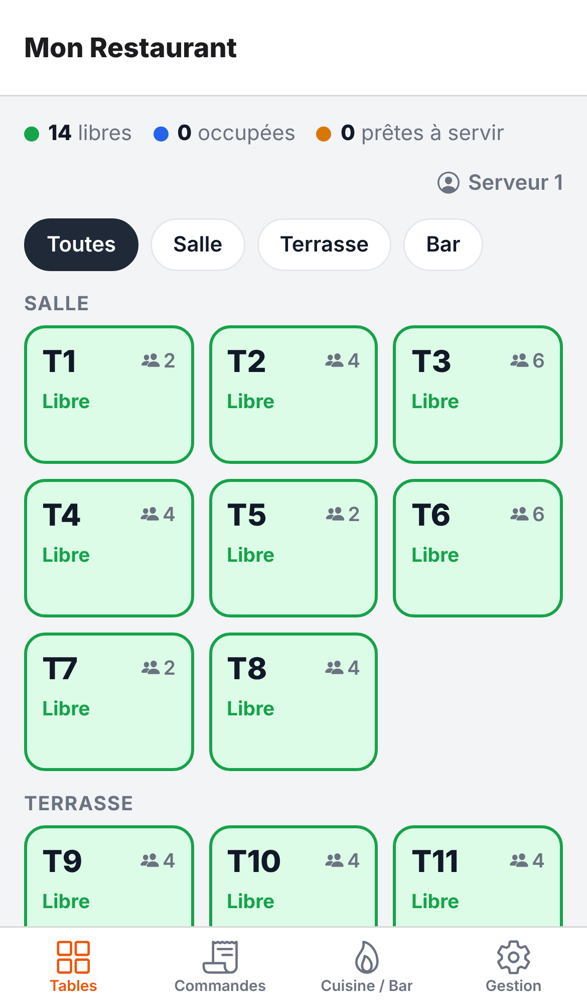

# Caisse Resto

Application de prise de commande pour restaurant, destinée aux serveurs.
Elle tourne sur **iPhone, Android** (et en bonus sur navigateur / tablette) à partir d’un seul code
(Expo / React Native).

| Tables | Prise de commande | Cuisine / Bar | Gestion |
|---|---|---|---|
|  |  |  |  |

## Fonctionnalités

**Onglet Tables**
- Plan de salle par zones (Salle, Terrasse, Bar…), filtre par zone.
- Couleur par état : libre, occupée, à envoyer, prête à servir.
- Montant en cours et temps écoulé sur chaque table occupée.
- Toucher une table libre ouvre une commande ; toucher une table occupée rouvre sa commande.

**Prise de commande**
- Carte par catégories + recherche, ajout d’un article en un geste.
- Ticket : quantités, couverts, notes par article (« saignant », « sans glaçons »…).
- **Envoyer** : les plats partent en cuisine, les boissons au bar (selon la catégorie).
  Chaque envoi crée un nouveau ticket (pratique pour entrée → plat → dessert).
- Marquer les articles prêts comme **servis**.
- **Encaisser** : espèces, carte ou autre, avec TVA incluse et montant par couvert.
- Annulation de commande.

**Onglet Commandes**
- Toutes les commandes en cours (ou seulement les miennes), avec l’état de chaque ligne.
- Commandes **à emporter**.
- Badge sur l’onglet quand des plats sont prêts à servir.

**Onglet Cuisine / Bar**
- Deux écrans séparés : Cuisine et Bar.
- Un ticket par envoi, avec chronomètre ; il passe en **rouge** après le délai d’alerte.
- Toucher une ligne : envoyé → en préparation → prêt. Boutons « Commencer » et « Prêt ».
- Liste des tickets prêts récemment, avec « Rappeler » en cas d’erreur.

**Onglet Gestion** (modifie tout le reste de l’application)
- **Articles & prix** : ajouter / modifier / supprimer, prix, catégorie, description,
  disponibilité (« épuisé » en un geste).
- **Catégories** : nom, couleur, envoi en cuisine ou au bar, ordre d’affichage.
- **Tables & zones** : ajout une par une ou en série (ex. T13 à T20), places, zone.
- **Serveurs** : ajout, renommage, suppression, choix du serveur sur l’appareil.
- **Restaurant** : nom, devise, taux de TVA, délai d’alerte cuisine.
- **Historique & statistiques** : CA, ticket moyen, couverts, moyens de paiement,
  meilleures ventes, commandes clôturées.
- Recharger la démo ou repartir de zéro.

Les données sont enregistrées **sur l’appareil** (elles restent après fermeture de l’app).

## Essayer l’application sur son téléphone (le plus rapide)

Prérequis : [Node.js](https://nodejs.org) 20 ou plus sur un ordinateur.

```bash
npm install
npx expo start
```

1. Installez **Expo Go** sur le téléphone (App Store ou Google Play).
2. Scannez le QR code affiché dans le terminal (appareil photo sur iPhone, Expo Go sur Android).
3. Le téléphone et l’ordinateur doivent être sur le même Wi-Fi (sinon : `npx expo start --tunnel`).

## Créer une application installable (APK Android, App Store, Play Store)

La compilation se fait dans le cloud avec **EAS Build** (pas besoin de Mac ni d’Android Studio).
Un compte gratuit sur [expo.dev](https://expo.dev) suffit pour commencer.

1. Changez les identifiants de l’application dans `app.json` pour les vôtres :
   `ios.bundleIdentifier` et `android.package` (ex. `com.monrestaurant.caisse`).
2. Connectez-vous et liez le projet :
   ```bash
   npx eas-cli@latest login
   npx eas-cli@latest init
   ```

**Android : fichier APK à installer directement**
```bash
npx eas-cli@latest build --platform android --profile preview
```
EAS donne un lien et un QR code pour télécharger l’APK sur les téléphones Android.

**iPhone**
Il faut un compte **Apple Developer** (99 $/an).
```bash
npx eas-cli@latest build --platform ios --profile production
npx eas-cli@latest submit --platform ios
```
L’application arrive dans **TestFlight** (pour l’installer sur vos iPhone), puis peut être publiée sur l’App Store.

**Google Play**
```bash
npx eas-cli@latest build --platform android --profile production
npx eas-cli@latest submit --platform android
```
(compte Google Play Console, 25 $ une fois).

## Version navigateur

```bash
npx expo export --platform web
```
Le dossier `dist/` peut être hébergé sur n’importe quel hébergeur statique ; sur téléphone,
« Ajouter à l’écran d’accueil » donne une icône comme une application.

## Limite actuelle : un appareil = ses propres données

Chaque téléphone ou tablette garde ses données en local. Si le serveur prend la commande sur son
téléphone, **la tablette de la cuisine ne la voit pas** : pour l’instant, l’onglet Cuisine / Bar
est utile sur le même appareil (ex. une tablette partagée au comptoir).

Pour synchroniser plusieurs appareils en temps réel, l’étape suivante est d’ajouter un serveur
(par exemple Supabase ou Firebase). Toute la logique est déjà regroupée dans `src/store/`,
ce qui facilite ce branchement.

## Développement

```bash
npm test            # tests de la logique (commandes, cuisine, encaissement, gestion)
npm run typecheck   # vérification TypeScript
```

Organisation du code :

```
src/
  app/                 écrans (Expo Router : chaque fichier = un écran)
    (tabs)/            les 4 onglets : Tables, Commandes, Cuisine / Bar, Gestion
    commande/[id].tsx  prise de commande et encaissement
    reglages/          écrans de modification (articles, catégories, tables…)
  store/               données, actions, calculs et sauvegarde sur l’appareil
  components/ui.tsx    boutons, champs, fenêtres, listes
  theme.ts             couleurs et libellés
```
